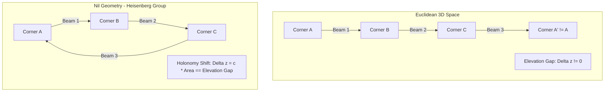
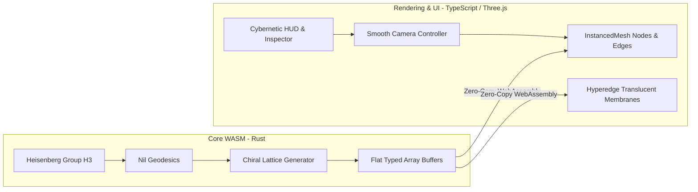

# Hyperbolic Nil Space

**Non-Euclidean Hypergraph Explorer & Physical Penrose Tribar in Nil Geometry**

Inspired by Eryk Kopczyński's (**ZenoRogue**) groundbreaking work in *HyperRogue*, *RogueViz*, and the demonstration *"Impossible Triangle Possible in Nil Geometry"*, this project provides a web application to explore and interact with 3D/4D non-Euclidean hypergraphs embedded within **Nil geometry** (the Thurston geometry modeled on the 3D Heisenberg group $\mathbb{H}_3$).

---

## 1. Mathematical Foundations of Nil Geometry

Nil geometry is one of the eight Thurston 3-manifold geometries. Topologically homeomorphic to $\mathbb{R}^3$, it is algebraically defined as the Lie group of upper triangular real matrices:

$$M(x, y, z) = \begin{pmatrix} 1 & x & z \\ 0 & 1 & y \\ 0 & 0 & 1 \end{pmatrix}$$

### Group Multiplication Law
$$(x_1, y_1, z_1) \cdot (x_2, y_2, z_2) = \big(x_1 + x_2,\; y_1 + y_2,\; z_1 + z_2 + c \cdot x_1 y_2\big)$$

where $c > 0$ is the metric torsion constant.

### Left-Invariant Riemannian Metric & Contact Form
The left-invariant Riemannian metric is:
$$ds^2 = dx^2 + dy^2 + (dz - c \cdot x\, dy)^2$$

The horizontal contact 1-form is:
$$\omega = dz - c \cdot x\, dy$$

The orthonormal left-invariant frame fields are:
$$X = \frac{\partial}{\partial x}, \quad Y = \frac{\partial}{\partial y} + c \cdot x \frac{\partial}{\partial z}, \quad Z = \frac{\partial}{\partial z}$$

Their Lie bracket yields the vertical fiber direction:
$$[X, Y] = X Y - Y X = c \cdot Z$$

Because $[X, Y] \neq 0$, **horizontal translations do not commute**.

---

## 2. Why the Penrose Triangle Closes in Nil Geometry

```text
 Euclidean Space (E³):                        Nil Geometry (H₃):
 ---------------------                        ------------------
       Corner A                                     Corner A
       /      \                                     /      \
      /        \                                   /        \
     /          \                                 /          \
 Corner B ---- Corner C                       Corner B ---- Corner C
 (Δz ≠ 0, elevation mismatch)                 (Δz - ∮ x dy = 0: closes seamlessly!)
```



### The Mechanism
1. **The Euclidean Impossibility:** In flat 3D space ($\mathbb{E}^3$), three orthogonal beams forming three apparent $90^\circ$ turns accumulate an elevation offset $\Delta z \neq 0$. They cannot meet without shearing or breaking.
2. **The Nil Cancellation:** By Green's / Stokes' theorem, traversing a closed curve $\gamma$ in the horizontal $(x, y)$ plane produces an intrinsic vertical holonomy:
   $$\Delta z = c \oint_\gamma x\, dy = c \iint_{\text{Int}(\gamma)} dx \wedge dy = c \cdot \text{Area}_{xy}(\gamma)$$
   When the triangle is embedded in Nil space with side length $L$, its enclosed area $A = \frac{\sqrt{3}}{4} L^2$ produces a vertical geometric translation $\Delta z = c \cdot A$. This intrinsic translation **exactly cancels the elevation gap**, allowing the three beams to join seamlessly into a continuous, physical 3D closed loop!

---

## 3. Natural Chiral Interleaving of Triangles

To interleave multiple impossible triangles into a coherent hypergraph macro-structure, we employ a **Chiral Kagome / Screw-Axis Lattice**:

1. **Chiral Alternation:** Adjacent triangles alternate orientation:
   - $\Delta$ orientation (counter-clockwise): $\text{Area} > 0 \implies \Delta z > 0$
   - $\nabla$ orientation (clockwise): $\text{Area} < 0 \implies \Delta z < 0$
   This ensures that the net topological flux across macro-cells is **zero**, preventing unbounded vertical drift.
2. **Fiber Stacking along Screw Axes:** Triangles are staggered along the $z$-fiber by fractions of the holonomy step $\frac{1}{2} \Delta z$, allowing each triangle's beam to interweave through the hollow aperture of its neighbor like Borromean rings.
3. **Hyperedges:** Each Penrose triangle is registered as a 3-uniform hyperedge (corner triad membrane). Adjacent triangles are coupled via 4-uniform relational hyperedges and bridge edges.

---

## 4. Architecture & Performance

```text
 +---------------------------------------------------------------+
 |                       Hyperbolic Nil Space                     |
 +-------------------------------+-------------------------------+
                                 |
         +-----------------------+-----------------------+
         |                                               |
         v                                               v
 +-------------------------------+       +-------------------------------+
 |      Core WASM (Rust)         |       |      Three.js WebGL Engine    |
 | - Heisenberg Group H3 Math    | <===> | - InstancedMesh Nodes & Edges |
 | - Closed-form Geodesics       |       | - Glowing Additive Materials  |
 | - Chiral Lattice Generator    |       | - Canonical Camera Snapping   |
 | - Flat Typed Array Buffers    |       | - Interactive Raycast Picking |
 +-------------------------------+       +-------------------------------+
```



- **Rust Core (`core-wasm`)**: Compiles to WebAssembly via `wasm-pack`. Exposes zero-allocation buffers for direct WebGL consumption.
- **InstancedMesh Rendering**: Nodes and edges are drawn using instanced geometry and dynamic color/scale transforms, ensuring a locked 60+ FPS in any modern web browser.
- **Canonical Perspective Snapping**: Selecting any Penrose triangle smoothly animates the camera to the exact axonometric vantage angle where the impossible triangle illusion snaps into place.

---

## 5. Getting Started

### Prerequisites
- Node.js $\ge 20$ (v24 recommended)
- Rust & Cargo (optional, for rebuilding `core-wasm`)

### Install Dependencies
```bash
npm install
```

### Run Development Server
```bash
npm run dev
```

### Run Automated Tests
```bash
npm test
```

### Build for Production
```bash
npm run build
```

---

## 6. Future Roadmap: Towards Hyperbolic-Nil Space

1. **Warped Nil-Hyperbolic Metrics:**
   Investigate Thurston's $\mathrm{Sol}$ geometry ($ds^2 = e^{2z} dx^2 + e^{-2z} dy^2 + dz^2$) and $\widetilde{\mathrm{SL}}_2(\mathbb{R})$, which twist hyperbolic planes $\mathbb{H}^2$ along a line bundle.
2. **4D Nil-Lorentzian Geometries:**
   Extending the contact connection to 4D spacetime bundles with Lorentzian signatures.
3. **Topological Rewriting & Hypergraph Mechanics:**
   Porting the RACOCI algebraic rewriting rules from the `holds` project to mutate hypergraph boundaries dynamically in non-Euclidean space.

---

## 7. License

MIT License.
